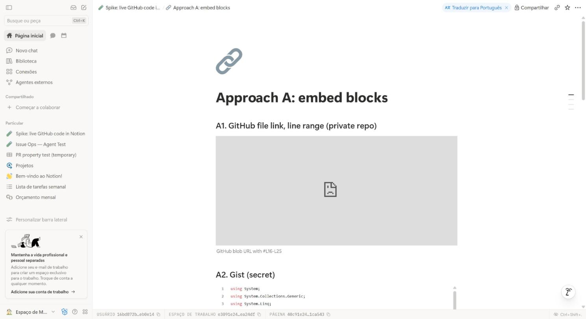
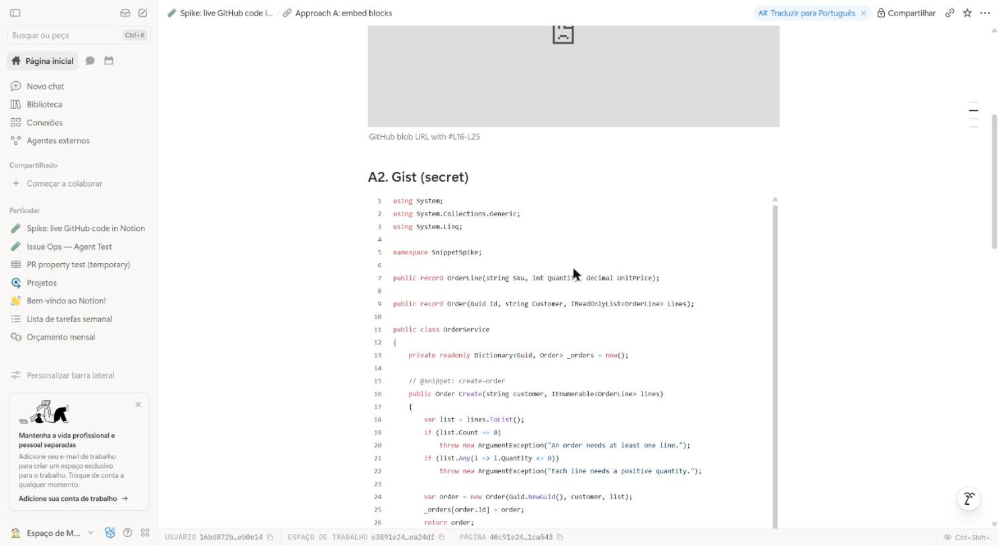
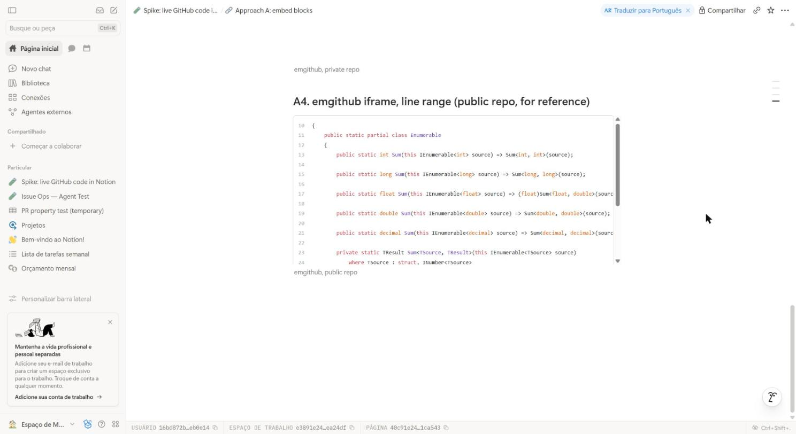
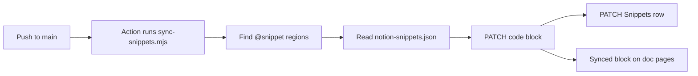
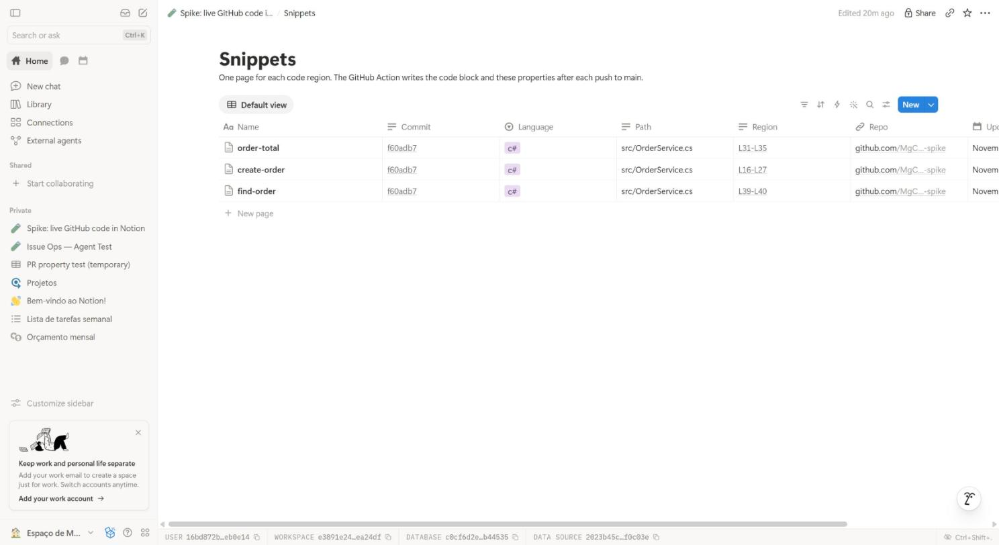
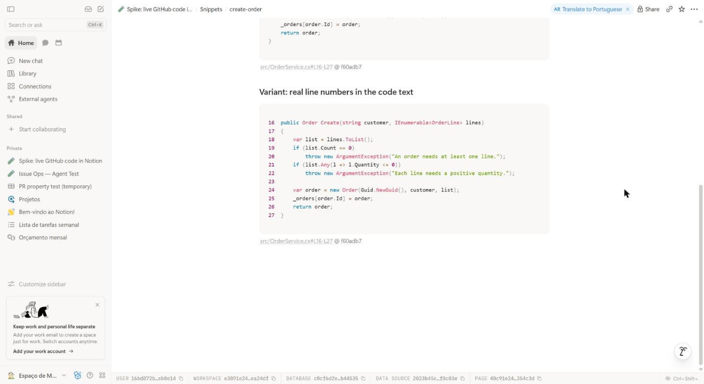

# Live GitHub code in Notion: spike

Approach B (a GitHub Action that writes native Notion code blocks) works end to end: a push to `main` updates the Notion block in about 22 seconds. Approach A (embed blocks) shows no code from a private repo; only a Gist copy works, and a push does not update it. Notion search and the Notion MCP read only the code of Approach B.

**Recommendation:** use Approach B for documentation in Notion.

Notion test page: [Spike: live GitHub code in Notion](https://www.notion.so/40c91e245786818b8b67f68c42e4b491) (private).

## Comparison

| Question | A: embed block | B: Action to code block |
|---|---|---|
| 1. Setup | 1 min, no secret | About 15 min: integration, secret, 2 files |
| 2. Partial region | emgithub only, public repos only | Yes, by `@snippet` markers |
| 3. Line numbers | Yes. Real only for a full file | No native option. Caption or numbers in text |
| 4. Look in Notion | iframe with fixed height and own style | Native code block with C# colors |
| 5. Refresh | Each page view. Gist: manual copy | Only on push to `main`. About 22 s |
| 6. Search, AI, MCP | Search, MCP: no. AI: Gist only | Search, AI and MCP: yes |

## Approach A: embed block

Test page: [Approach A: embed blocks](https://www.notion.so/40c91e2457868133844ed1c3ff1ca543).

| Embed | URL type | Result in Notion |
|---|---|---|
| A1 | GitHub file URL with `#L16-L25` | Grey box, no code. GitHub sends `X-Frame-Options: deny` |
| A2 | Secret Gist | Full file, lines 1-42, colors. No line range |
| A3 | emgithub, private repo | `404 Failed to download` |
| A4 | emgithub, public repo | Lines 10-30 with real line numbers |

- A Gist is a separate copy. The push to the repo did not change it. The spike changed it with `gh gist edit`, and Notion then showed the new code.
- emgithub reads `raw.githubusercontent.com` without a token. Thus it works only for public repos.
- The Notion MCP returns only the `<embed source="...">` URL and the caption. Notion search finds the headings, but no code.
- Notion AI read the Gist code. It could not load the private emgithub embed.








## Approach B: GitHub Action to native code block

### Flow



### Parts

| File | Purpose |
|---|---|
| [`src/OrderService.cs`](src/OrderService.cs) | Sample code with 3 regions |
| [`scripts/sync-snippets.mjs`](scripts/sync-snippets.mjs) | Finds regions and writes Notion blocks. No dependencies |
| [`notion-snippets.json`](notion-snippets.json) | Manifest: snippet name to Notion page |
| [`.github/workflows/notion-snippets.yml`](.github/workflows/notion-snippets.yml) | Runs the script on push to `main` |

A region in the source:

```csharp
// @snippet: order-total
public decimal Total(Order order)
{
    var subtotal = order.Lines.Sum(l => l.Quantity * l.UnitPrice);
    return Math.Round(subtotal, 2, MidpointRounding.AwayFromZero);
}
// @end-snippet
```

A manifest entry. The script finds the first code block on the page, also inside a synced block. If you give `block`, the script uses that block ID directly.

```json
{ "snippet": "order-total", "page": "40c91e245786810bb058d0d7fcb446da" }
```

### Notion structure

| Item | Contents |
|---|---|
| Snippets database | One page for each snippet. Properties: Repo, Path, Region, Language, Commit, Updated |
| Snippet page | Original synced block with the code block |
| Doc page | Prose and a synced block reference for each snippet |

The Action writes only the original block. The synced block reference on the [doc page](https://www.notion.so/40c91e2457868153bdb1f981af6e2f49) shows the new code at the same time.




### Test runs

| Run | Change | Blocks updated | API calls | Time |
|---|---|---|---|---|
| [41483652691](https://github.com/MgCohen/notion-snippet-spike/actions/runs/41483652691) | First sync | 4 | 15 | 15 s |
| [41483858624](https://github.com/MgCohen/notion-snippet-spike/actions/runs/41483858624) | 2 regions changed, lines moved | 4 | 15 | 22 s from push |
| [41484007049](https://github.com/MgCohen/notion-snippet-spike/actions/runs/41484007049) | Script only, no region change | 0 | 8 | 16 s |

In the second run, `create-order` became 2 lines longer. The markers kept each region correct: `order-total` moved from `L29-L33` to `L31-L35`, and the caption shows the new range.

### Line numbers

Notion code blocks have no line-number option. The spike tested two ways to show the real file line numbers.

| Way | Example | Copy and search | Look |
|---|---|---|---|
| Caption | `src/OrderService.cs#L16-L27 @ f60adb7` | Clean code | Small grey line under the block |
| Numbers in the code text | `21  if (list.Any(...))` | Numbers go into copy and search | Like an editor, number on each line |



Numbers in the code text look better. Use them when the prose refers to specific lines. Use the caption in all other cases, because copy and search then get clean code. Both ways keep the caption, which links to GitHub at the exact commit and line range.

### Cost

| Item | Value |
|---|---|
| API calls, all regions changed | 4 for each snippet: 2 GET, 2 PATCH |
| API calls, no region changed | 2 GET for each snippet |
| API calls with `block` IDs | 1 GET for each snippet, plus 2 PATCH on a change |
| Notion rate limit | 3 requests/second on average |
| Action time | 15 to 18 s, 1 billed minute for each push |

If a region does not change, the script does not write the block. The caption then keeps the older commit. That permalink shows the same code.

### Search, Notion AI and MCP

| Reader | Result |
|---|---|
| Notion search | Found the new code some seconds after the run |
| Notion AI | Quoted `return Math.Round(subtotal, 2, MidpointRounding.AwayFromZero);` |
| Notion MCP `fetch` | Returns the code on the snippet page and the doc page |

- A search hit points to the Snippets page, not to the doc page with the synced block reference.
- The MCP `fetch` does not return the caption.


## Setup for Approach B

1. Make an internal Notion integration with "read content" and "update content".
2. Connect the integration to the parent page of the Snippets database.
3. Run `gh secret set NOTION_TOKEN -R <owner>/<repo>`. Do not commit the token.
4. Copy `scripts/sync-snippets.mjs` and `.github/workflows/notion-snippets.yml` into the repo.
5. Add `// @snippet: name` and `// @end-snippet` around each region.
6. Make a Snippets page for each region, with a synced block that holds a code block.
7. Add each snippet to `notion-snippets.json`.
8. Run `node scripts/sync-snippets.mjs --dry-run` to see the regions.

## Limits and open points

- Do not edit a synced code block in Notion. The next change of that region replaces the edit.
- The Snippets page and the manifest are manual work for each new snippet. A next step can make the Snippets page from the script when a new marker appears.
- The Notion token was shared in a chat. Rotate it in the Notion integration settings, then run `gh secret set NOTION_TOKEN` again.
