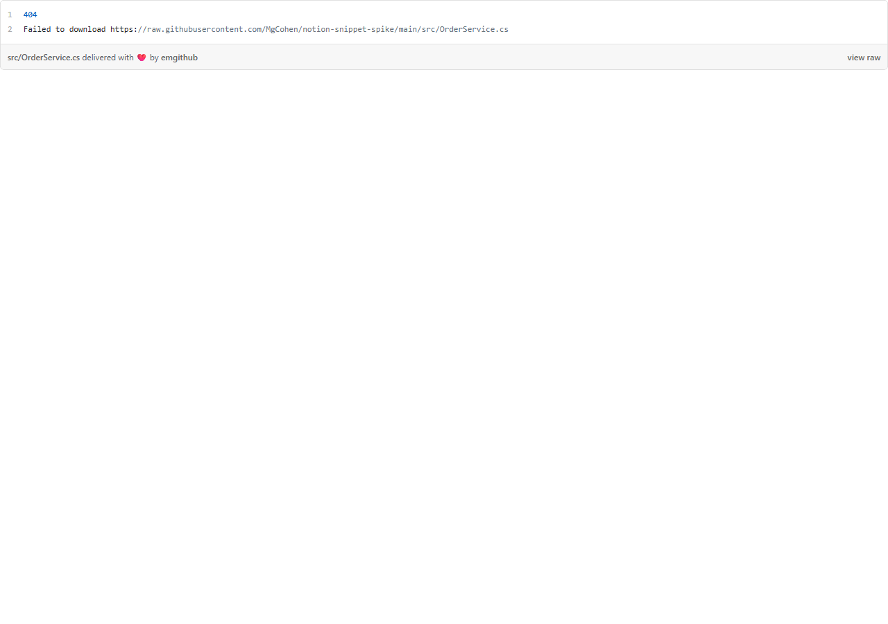
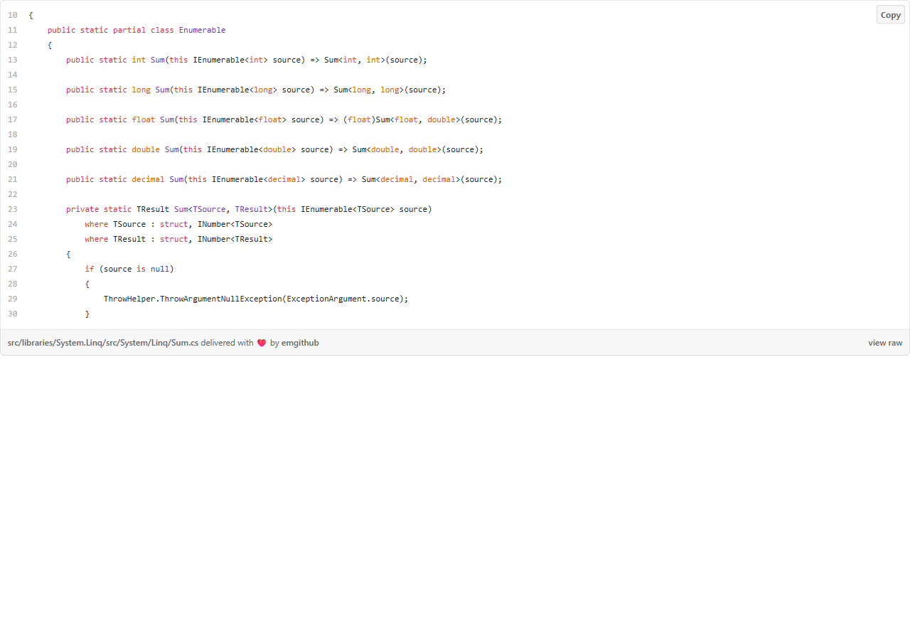
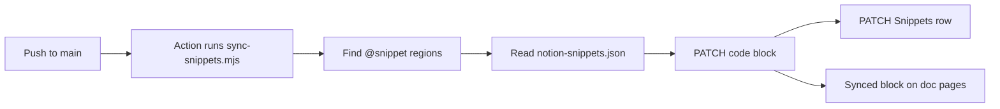

# Live GitHub code in Notion: spike

Approach B (a GitHub Action that writes native Notion code blocks) works end to end. A push to `main` updates the Notion block in about 22 seconds. Approach A (embed blocks) cannot show code from a private repo, and Notion search, Notion AI and the Notion MCP cannot read embedded code.

**Recommendation:** use Approach B for documentation in Notion.

Notion test page: [Spike: live GitHub code in Notion](https://www.notion.so/40c91e245786818b8b67f68c42e4b491) (private).

## Comparison

| Question | A: embed block | B: Action to code block |
|---|---|---|
| 1. Setup | 1 min, no secret. Private repo: does not work | About 15 min: integration, secret, 2 files |
| 2. Partial region | emgithub only (`#L10-L30`), public repos only | Yes, by `@snippet` markers |
| 3. Line numbers | emgithub: real numbers. Gist: Gist numbers | No native option. Caption `path#L16-L27` with permalink |
| 4. Look in Notion | iframe, own style, fixed height | Native code block, C# colors, caption |
| 5. Refresh | Each page view. GitHub raw cache: 300 s | Only on push to `main`. About 22 s |
| 6. Search, AI, MCP | Cannot read the code. Only URL and caption | Search and MCP read the code. AI: expected |

## Approach A: embed block

Test page: [Approach A: embed blocks](https://www.notion.so/40c91e2457868133844ed1c3ff1ca543).

| Embed | URL type | Result |
|---|---|---|
| A1 | GitHub file URL with `#L16-L25` | GitHub sends `X-Frame-Options: deny`. Private file gives 404 without login |
| A2 | Secret Gist | A copy of the file. A push to the repo does not change it |
| A3 | emgithub, private repo | 404: emgithub reads `raw.githubusercontent.com` without a token |
| A4 | emgithub, public repo | Works: line range, real line numbers, colors |





The Notion MCP returns only the `<embed source="...">` URL and the caption for this page. Notion search finds the headings of this page, but no code text. The code is in an iframe, so it is not part of the page.

## Approach B: GitHub Action to native code block

### Flow



### Parts

| File | Purpose |
|---|---|
| [`src/OrderService.cs`](src/OrderService.cs) | Sample code with 3 regions |
| [`scripts/sync-snippets.mjs`](scripts/sync-snippets.mjs) | Finds regions and writes Notion blocks. No dependencies |
| [`notion-snippets.json`](notion-snippets.json) | Manifest: snippet name to Notion page |
| [`.github/workflows/notion-snippets.yml`](.github/workflows/notion-snippets.yml) | Runs the script on push to `main` |

A region in the source:

```csharp
// @snippet: order-total
public decimal Total(Order order)
{
    var subtotal = order.Lines.Sum(l => l.Quantity * l.UnitPrice);
    return Math.Round(subtotal, 2, MidpointRounding.AwayFromZero);
}
// @end-snippet
```

A manifest entry. The script finds the first code block on the page, also inside a synced block. If you give `block`, the script uses that block ID directly.

```json
{ "snippet": "order-total", "page": "40c91e245786810bb058d0d7fcb446da" }
```

### Notion structure

| Item | Contents |
|---|---|
| Snippets database | One page for each snippet. Properties: Repo, Path, Region, Language, Commit, Updated |
| Snippet page | Original synced block with the code block |
| Doc page | Prose and a synced block reference for each snippet |

The test doc page is [Approach B: doc page with synced snippets](https://www.notion.so/40c91e2457868153bdb1f981af6e2f49). The Action writes only the original block. The reference on the doc page shows the new code at the same time.

### Test runs

| Run | Change | Blocks updated | API calls | Time |
|---|---|---|---|---|
| [41483652691](https://github.com/MgCohen/notion-snippet-spike/actions/runs/41483652691) | First sync | 4 | 15 | 15 s |
| [41483858624](https://github.com/MgCohen/notion-snippet-spike/actions/runs/41483858624) | 2 regions changed, lines moved | 4 | 15 | 18 s run, 22 s from push |
| [41484007049](https://github.com/MgCohen/notion-snippet-spike/actions/runs/41484007049) | Script only, no region change | 0 | 8 | 16 s |

In the second run, `create-order` became 2 lines longer. The markers kept each region correct: `order-total` moved from `L29-L33` to `L31-L35`, and the caption shows the new range.

### Line numbers

Notion code blocks have no line-number option. The spike tested two ways to show the real file line numbers.

| Way | Example | Copy and search | Result |
|---|---|---|---|
| Caption | `src/OrderService.cs#L16-L27 @ f60adb7`, link to the permalink | Clean code | **Recommended** |
| Numbers in the code text | `21  if (list.Any(l => l.Quantity <= 0))` | Numbers go into copy and search | Use only for line-by-line text |

The caption link opens GitHub at the exact commit and line range. Notion search showed the numbers inside the highlight text for the numbered variant.

### Cost

| Item | Value |
|---|---|
| API calls, all regions changed | 4 for each snippet: 2 GET, 2 PATCH |
| API calls, no region changed | 2 GET for each snippet |
| API calls with `block` IDs | 1 GET for each snippet, plus 2 PATCH on a change |
| Notion rate limit | 3 requests/second on average |
| Action time | 15 to 18 s, 1 billed minute for each push |

If a region does not change, the script does not write the block. The caption then keeps the older commit. That permalink shows the same code.

### Search, Notion AI and MCP

- Notion search found `MidpointRounding.AwayFromZero` and `Each line needs a positive quantity` some seconds after the run.
- A search hit points to the Snippets page, not to the doc page with the synced block reference.
- The Notion MCP `fetch` returns the code on the snippet page and on the doc page. It does not return the caption.
- Notion AI was not tested directly. It reads page blocks, so it should read native code blocks.

## Setup for Approach B

1. Make an internal Notion integration with "read content" and "update content".
2. Connect the integration to the parent page of the Snippets database.
3. Run `gh secret set NOTION_TOKEN -R <owner>/<repo>`. Do not commit the token.
4. Copy `scripts/sync-snippets.mjs` and `.github/workflows/notion-snippets.yml` into the repo.
5. Add `// @snippet: name` and `// @end-snippet` around each region.
6. Make a Snippets page for each region, with a synced block that holds a code block.
7. Add each snippet to `notion-snippets.json`.
8. Run `node scripts/sync-snippets.mjs --dry-run` to see the regions.

## Limits and open points

- Do not edit a synced code block in Notion. The next change of that region replaces the edit.
- The Snippets page and the manifest are manual work for each new snippet. A next step can make the Snippets page from the script when a new marker appears.
- Screenshots of the Notion pages are not in this report. The Claude in Chrome extension was not connected to the Claude Code session.
- The Notion token was shared in a chat. Rotate it in the Notion integration settings, then run `gh secret set NOTION_TOKEN` again.
