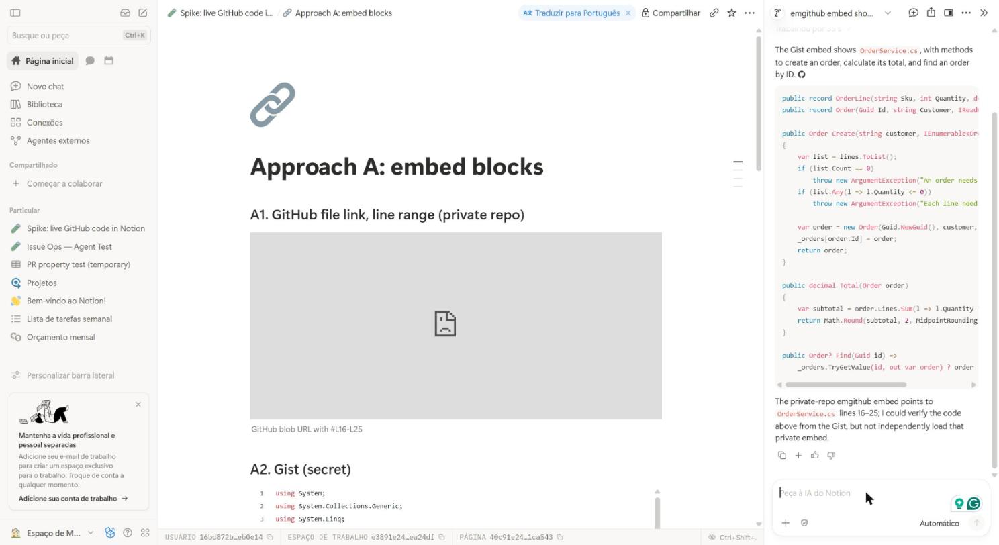
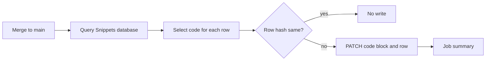
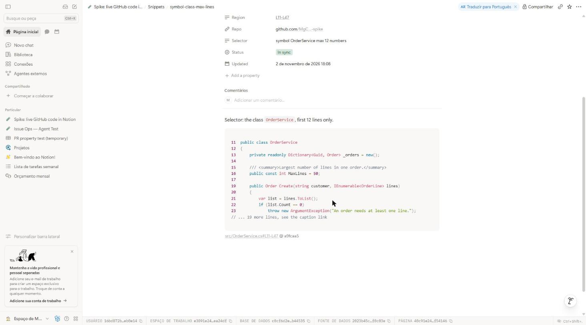

# Live GitHub code in Notion: spike

Approach B (a GitHub Action that writes native Notion code blocks) works end to end: a merge to `main` updates the Notion blocks in about 18 seconds. A Notion database is the registry of all code blocks, so each run knows which blocks changed. Approach A (embed blocks) shows no code from a private repo, and Notion search and the Notion MCP cannot read embedded code.

**Recommendation:** use Approach B for documentation in Notion.

Notion test page: [Spike: live GitHub code in Notion](https://www.notion.so/40c91e245786818b8b67f68c42e4b491) (private).

## Comparison

| Question | A: embed block | B: Action to code block |
|---|---|---|
| 1. Setup | 1 min, no secret | About 15 min: integration, secret, 2 files |
| 2. Partial region | emgithub only, public repos only | Line range, symbol, marker or whole file |
| 3. Line numbers | Yes. Real only for a full file | Real numbers: caption range or in the text |
| 4. Look in Notion | iframe with fixed height and own style | Native code block with C# colors |
| 5. Refresh | Each page view. Gist: manual copy | On merge, PR plan, nightly or manual |
| 6. Search, AI, MCP | Search, MCP: no. AI: Gist only | Search, AI and MCP: yes |

## Approach A: embed block

Test page: [Approach A: embed blocks](https://www.notion.so/40c91e2457868133844ed1c3ff1ca543).

| Embed | URL type | Result in Notion |
|---|---|---|
| A1 | GitHub file URL with `#L16-L25` | Grey box, no code. GitHub sends `X-Frame-Options: deny` |
| A2 | Secret Gist | Full file, Gist line numbers, colors. No line range |
| A3 | emgithub, private repo | `404 Failed to download` |
| A4 | emgithub, public repo | Lines 10-30 with real line numbers |

- A Gist is a separate copy. A push to the repo does not change it.
- emgithub reads `raw.githubusercontent.com` without a token. Thus it works only for public repos.
- The Notion MCP returns only the embed URL and the caption. Notion search finds no code.
- Notion AI read the Gist code. It could not load the private emgithub embed.

## Approach B: GitHub Action to native code block

### Flow

| File | Purpose |
|---|---|
| [`scripts/sync-snippets.mjs`](scripts/sync-snippets.mjs) | Selects code and writes Notion blocks. No dependencies |
| [`.github/workflows/notion-snippets.yml`](.github/workflows/notion-snippets.yml) | Triggers and modes |
| [`notion-snippets.json`](notion-snippets.json) | Repo name and Snippets database ID |
| [`src/OrderService.cs`](src/OrderService.cs) | Sample code |

### Registry: the Snippets database

Each row is one Notion code block. A person writes the input. The Action writes the output.

| Property | Written by | Example |
|---|---|---|
| Selector | Person | `lines 19-30`, `symbol OrderService.Total` |
| Path | Person (Action for `snippet`) | `src/OrderService.cs` |
| Status, Message | Action | `In sync`, or `Error` with the reason |
| Hash, Block ID | Action | `76440fc9f43a18c5`, ID of the code block |
| Region, Commit | Action | `L19-L30` and `a9fcaa5`, both links to GitHub |

The code block is the first code block on the row page. Doc pages show it with a synced block reference, and the reference shows each update at the same time.

### Selectors

| Selector | Selects | Follows code changes |
|---|---|---|
| `lines 16-27` | Line range | Yes, by the git diff since the last sync |
| `lines 16-27 @f60adb7` | Line range at a fixed commit | No, it never changes |
| `file` | Whole file | Yes |
| `symbol OrderService.Total` | Class, record or method | Yes, by name |
| `snippet create-order` | `// @snippet:` to `// @end-snippet` | Yes, by marker |

Options after a selector:

- `max 12`: shows the first 12 lines, then `// ... 14 more lines, see the caption link`. Notion code blocks have no height limit or scroll.
- `numbers`: puts the real file line numbers in the code text.

The `lines` selector follows the code. Before each sync, the script reads `git diff` from the commit of the last sync. If lines above the range change, the range moves, and the Action writes the new `Selector`. If the diff touches the range, the summary says "edited".

### Change detection

The hash is for one row only: language, `path#Lx-Ly` and the selected code text. The commit is not in the hash.

| Change in a push | Result for a row | Notion calls |
|---|---|---|
| Other file, or other region of the same file | No write | 0 |
| Code of the region | Write block and row | 2 |
| Lines above the region only | Write: the caption range changed | 2 |
| Selector finds no code | `Status` = Error, run fails | 1, then 0 while the error stays |

Each run also does 1 database query for each 100 rows.

### Triggers

| Trigger | Mode | Purpose |
|---|---|---|
| Push to `main` (PR merge) | apply | Write the blocks that changed |
| Pull request | plan | List the blocks that the merge changes. Writes nothing |
| Nightly schedule | apply | Give code to rows added in Notion |
| Manual (`gh workflow run`) | plan, apply or force | `force` writes all blocks again |

A Notion button that starts the workflow (`repository_dispatch`) is possible, but the spike did not test it.

### Test runs

| Run | Event | Result | API calls |
|---|---|---|---|
| [41487744189](https://github.com/MgCohen/notion-snippet-spike/actions/runs/41487744189) | First registry run | 9 new | 31 (finds block IDs) |
| [41488112900](https://github.com/MgCohen/notion-snippet-spike/actions/runs/41488112900) | [PR #1](https://github.com/MgCohen/notion-snippet-spike/pull/1) plan | 8 will update, 1 unchanged | 1 |
| [41488181759](https://github.com/MgCohen/notion-snippet-spike/actions/runs/41488181759) | Merge of PR #1 | 8 updated, 1 unchanged, 18 s | 17 |
| [41488311983](https://github.com/MgCohen/notion-snippet-spike/actions/runs/41488311983) | Manual, 1 bad selector | 9 unchanged, 1 error | 2 |

PR #1 added 3 lines above `Create` and changed `Total`. The pinned range was the only unchanged row.

### Line numbers

Notion code blocks have no line-number option. Each block gets a caption with the real range, for example `src/OrderService.cs#L19-L30 @ a9fcaa5`. The caption links to GitHub at that commit and range.

| Way | Copy and search | Look |
|---|---|---|
| Caption only | Clean code | Small grey line under the block |
| `numbers` option | Numbers go into copy and search | Like an editor |

Numbers in the text look better. Use `numbers` when the prose refers to specific lines. Use the caption only in all other cases.

### Search, Notion AI and MCP

| Reader | Result |
|---|---|
| Notion search | Found the new code some seconds after the run |
| Notion AI | Quoted `return Math.Round(subtotal, 2, MidpointRounding.AwayFromZero);` |
| Notion MCP `fetch` | Returns the code on the row page and the doc page |

- A search hit points to the row page, not to the doc page with the synced block reference.
- The MCP `fetch` does not return the caption.

## Related tools

No known tool writes a code region into a native Notion code block (search of November 2026).

| Tool | What it does | Gap |
|---|---|---|
| [SnippSync](https://www.producthunt.com/p/snippsync/snippsync) | Line range from GitHub, updates on push | iframe embed, like Approach A. Paid |
| [notion-docs-sync](https://github.com/imnotjames/notion-docs-sync), [sync-repo-docs-to-notion](https://github.com/pechorin/sync-repo-docs-to-notion) | Repo Markdown files to Notion pages | Full pages only |
| [Notion GitHub integration](https://www.notion.com/zh-cn/help/guides/bring-your-codebase-into-context-with-notions-github-integration) | PR and issue previews, line permalinks | A link, no code |
| [MarkdownSnippets](https://mysticmind-dev.pages.dev/how-to-keep-dotnet-documentation-code-samples-in-sync-with-code-base), [snex](https://github.com/pellepelster/snex), [Swimm](https://docs.swimm.io/ide-integrations/vs-code/ide-plugins-vscode-keep-docs-up-to-date) | Snippets in repo docs stay equal to code | Markdown in the repo, not Notion |

## Setup for Approach B

1. Make an internal Notion integration with "read content" and "update content".
2. Connect the integration to the page that holds the Snippets database.
3. Run `gh secret set NOTION_TOKEN -R <owner>/<repo>`. Do not commit the token.
4. Copy `scripts/sync-snippets.mjs` and `.github/workflows/notion-snippets.yml` into the repo.
5. Write the repo name and the database ID in `notion-snippets.json`.
6. For each code block, add a row with `Selector`, `Path` and an empty code block.
7. Run `gh workflow run notion-snippets.yml -f mode=plan` to see the result first.

## Limits and open points

- Do not edit a synced code block in Notion. The next change of that row replaces the edit.
- The `symbol` selector reads C#-like syntax with a simple parser. Roslyn is more correct for C#.
- C# `#region name` blocks are not a selector yet. A small change to the marker pattern can add them.
- Notion makes `OrderService.Total` in a text property a link. The script reads the plain text, so the selector still works.
- The Notion token was shared in a chat. Rotate it in the Notion integration settings, then run `gh secret set NOTION_TOKEN` again.
