# Live GitHub code in Notion: spike

Three approaches show live GitHub code in Notion. **B** (native code block) is the only one that Notion search, the Notion MCP and the Notion API read as code. **C** (HTML block) looks best: real line numbers, scroll and colors. **A** (emgithub embed) works with no setup, but only for a public repo, and its line range does not follow the code.

**Recommendation:** one GitHub Action and one Snippets database. Write a native code block (B) for search, MCP and API, and an HTML block (C) for the view on doc pages.

Notion test page: [Spike: live GitHub code in Notion](https://www.notion.so/40c91e245786818b8b67f68c42e4b491) (private). Repo: public since the emgithub test.

## Comparison

| Question | A: emgithub embed | B: native code block | C: HTML block |
|---|---|---|---|
| 1. Setup | 1 min. Public repo only | Action, token, database | Same Action as B |
| 2. Partial region | Fixed line range in the URL | Range, method, file | Same properties as B |
| 3. Line numbers | Real, in the frame | Caption range | Real, in a column |
| 4. Look in Notion | Frame, scroll inside | Native block, no scroll | Frame, scroll, colors |
| 5. Refresh | Page view, 2.5 min after push | Action, 20 s after merge | Action, by API (tested: 1.3 s) |
| 6. Search, AI, MCP | AI only | Search, AI, MCP | AI only |

### What a program reads through the Notion API

Full output of each test page read through the API: [`docs/read-output/`](docs/read-output/).

| Approach | API result | Code readable? |
|---|---|---|
| A: embed | `[embed] url: https://emgithub.com/iframe.html?target=...` | No. Only the URL |
| B: synced code block | `[synced_block] reference` → `[code] language=c# caption="src/OrderService.cs#L36-L42 @ 9c420b3"` and the code | Yes, directly |
| C: HTML block | `[embed] url: https://prod-files-secure.s3...order-service.html` | Yes, after a second download, inside HTML |

B output for the doc page (shortened):

```
## How the total is calculated
[synced_block] reference to accb2cb1-f643-46a7-a8d1-af84950d45e6
  [code] language=c# caption="src/OrderService.cs#L36-L42 @ 9c420b3"
    | public decimal Total(Order order)
    | {
    |     var subtotal = order.Lines.Sum(l => l.Quantity * l.UnitPrice);
    |     if (subtotal < 0)
    |         throw new InvalidOperationException($"A total cannot be negative: {subtotal}.");
    |     return Math.Round(subtotal, 2, MidpointRounding.AwayFromZero);
    | }
```

## All options: one push, measured

Test: commit `9c420b3` added 2 lines above `Create` and changed one line in `Total`. Push at 17:18:51 UTC.

| Option | Shows | Refresh after the push | Steps and cost | Search, AI, MCP |
|---|---|---|---|---|
| A1 GitHub file link | Nothing, private and public repo | None | None | No |
| A1b GitHub link as bookmark | Card with "github.com" and the URL | None | None | No |
| A2 Gist | Whole file only | At page view, after a Gist update | Gist update for each push. Not automated: needs a PAT | AI only |
| A5 emgithub, range on `main` | Line range | 2 min 28 s (CDN cache, 5 min maximum) | None. Range drifts: wrong lines after the push | AI only |
| A6 emgithub, fixed commit | Line range | Never | Edit the URL by hand for each change | AI only |
| A7 emgithub, whole file | Whole file, scroll | 2 min 28 s | None | AI only |
| B Action, registry | Range, method, file | 22 s | None. 1 API call, plus 2 for each changed block | Search, AI, MCP |

- No option needs an agent. Only A2 and A6 need a manual step.
- B runs on GitHub Actions: free minutes on a public repo, about 1 billed minute for each push on a private repo.
- emgithub reads `raw.githubusercontent.com` without a token. A private repo gives 404 (A3). emgithub is a free third-party site, so it is also a dependency.
- The Notion MCP returns only the embed URL and caption. Notion search found `public int Count => _orders.Count;` only in the Approach B pages.

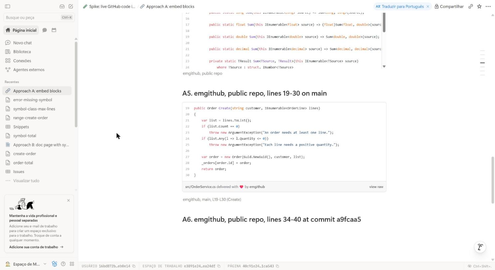

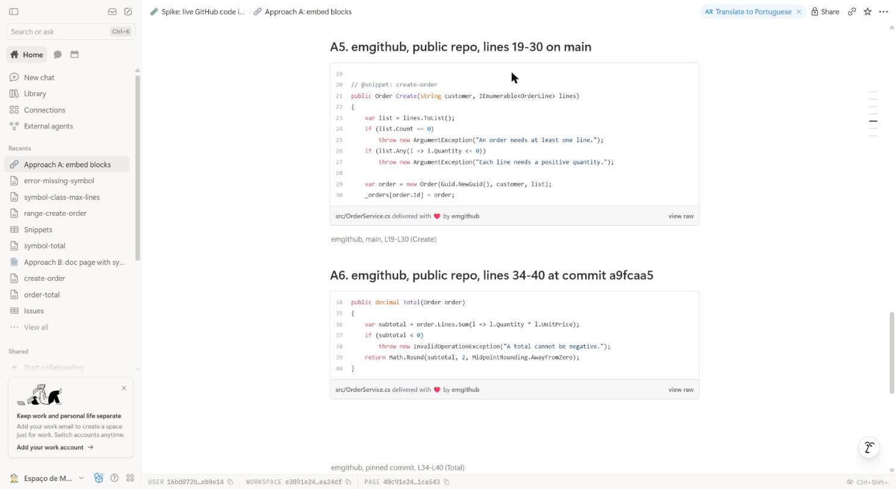

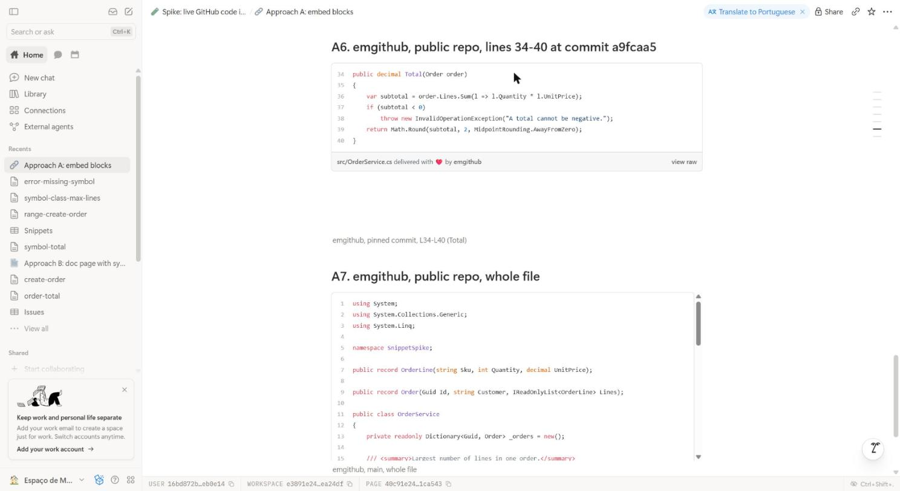

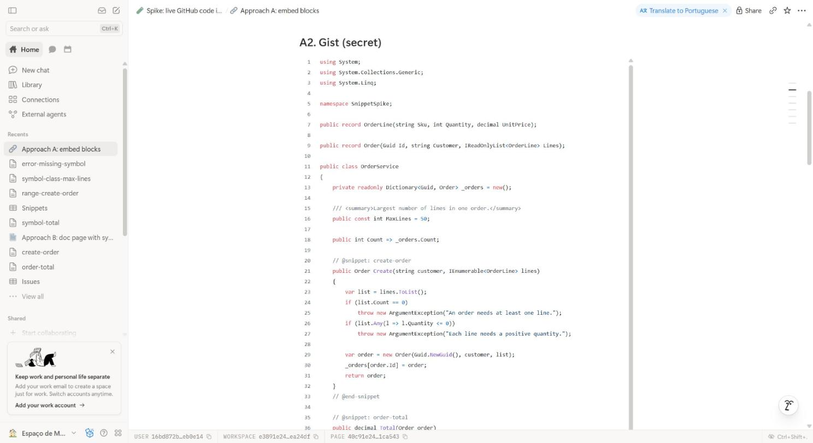

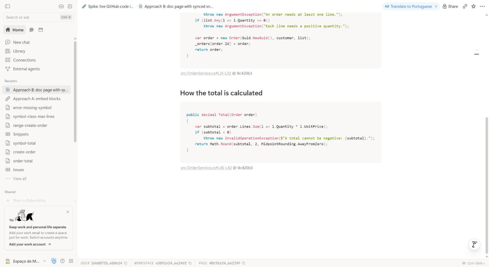

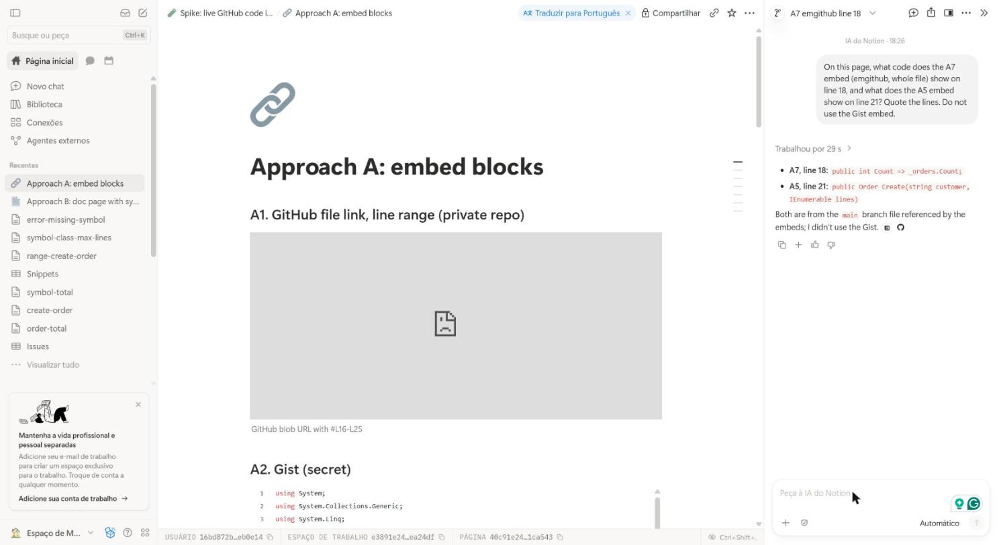

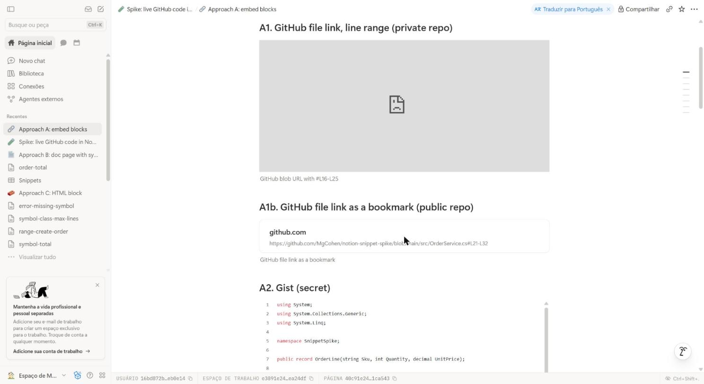

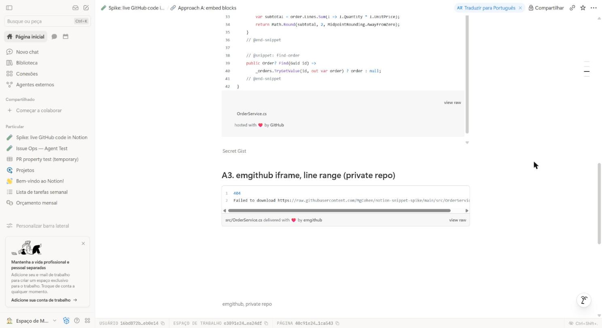

## Approach C: HTML block

Test page: [Approach C: HTML block](https://www.notion.so/40c91e2457868140b52ffc9112d923e8).

| Check | Result |
|---|---|
| Real line numbers, aligned | Yes (11-49, then 21-32) |
| Height limit with scroll | Yes, vertical and horizontal, inside the block |
| Colors | Yes. highlight.js loads from a CDN in the frame |
| Update by API (no person) | Yes: 4 calls, 1.3 s. Upload file, then `PATCH` the block with `embed.file_upload` |
| Private repo | Yes. The code is in the file, not fetched from GitHub |
| Reuse on many pages | Yes. HTML block in a synced block. One API update showed on the doc page reference |
| Notion AI | Read line 18 from the HTML file |
| Notion search | No. Only the page text matched |
| Notion MCP `fetch` | No. Only a file reference |

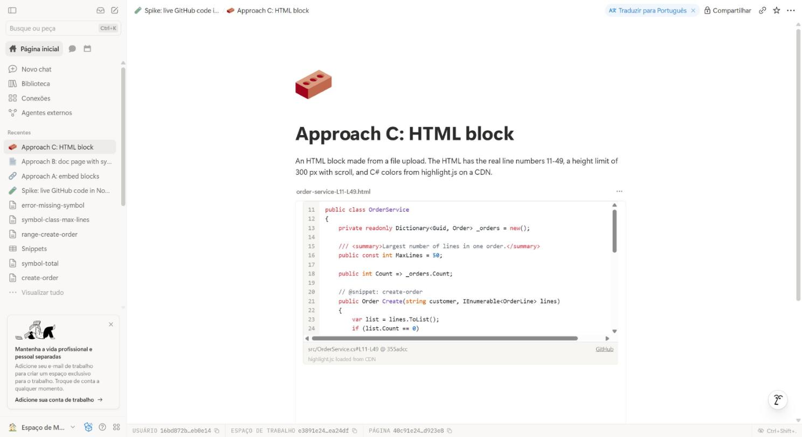

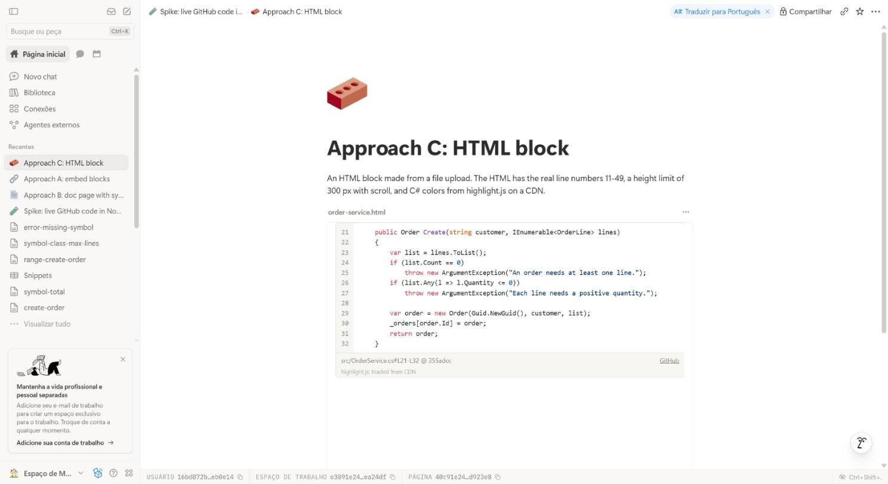

## Approach B: GitHub Action to native code block

### Flow

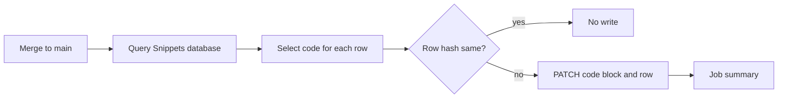

| File | Purpose |
|---|---|
| [`.github/notion-snippets/`](.github/notion-snippets/) | Python tools: select code, write Notion blocks. Copy of the `notion-snippets` plugin in [MgCohen/claude-plugins](https://github.com/MgCohen/claude-plugins) |
| [`.github/workflows/notion-snippets.yml`](.github/workflows/notion-snippets.yml) | Triggers and modes |
| [`src/OrderService.cs`](src/OrderService.cs) | Sample code |

### Registry: the Snippets database

Each row is one Notion code block. A person writes the input. The Action writes the output.

| Property | Written by | Example |
|---|---|---|
| File | Person | `https://github.com/MgCohen/notion-snippet-spike/blob/main/src/OrderService.cs` |
| Method, Overload | Person | `OrderService.Total`, `2` |
| Start line, End line | Person (Action when the range moves) | `19`, `30` |
| Lines before, Lines after | Person | `3`, `2` |
| Status, Message | Action | `In sync`, or `Error` with the reason |
| Hash | Action | `76440fc9f43a18c5` |
| Region | Action | `L19-L30`, a link to GitHub at the synced commit |

The code block is the first code block on the row page. Doc pages show it with a synced block reference, and the reference shows each update at the same time.

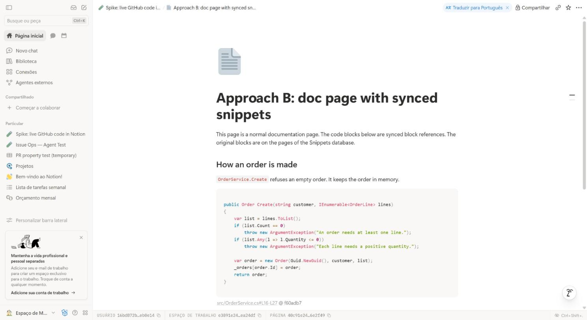

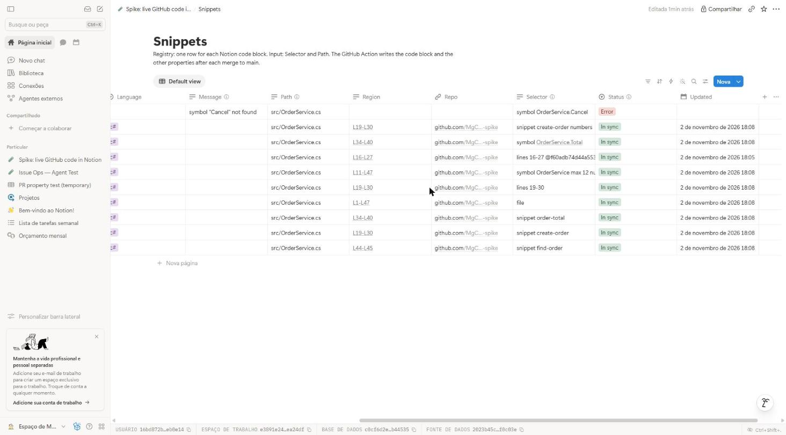

### Code selection

[`snippet_range.py`](.github/notion-snippets/snippet_range.py) finds the lines from the row properties. The tests are in the plugin.

| Properties | Selects | Follows code changes |
|---|---|---|
| Method `OrderService.Total` | The declaration: method, property, field or type | Yes, by name |
| Method `Total`, Overload `2` | The second declaration named `Total` | Yes, by name |
| Start line `16`, End line `27` | Line range | Yes, by the git diff since the last sync |
| File with a commit, Start line, End line | Line range at a fixed commit | No, it never changes |
| No Method and no lines | Whole file | Yes |

- If Method has a value, the Action ignores Start line and End line.
- Lines before and Lines after add lines on each side, with a method or with a line range.
- Rows with a File in a different repo are skipped. One Snippets database can serve many repos, and each repo has its own Action.
- The method search masks comments and strings, and skips calls. It reads C#, TypeScript and JavaScript.

A line range follows the code. Before each sync, the script reads `git diff` from the commit of the last sync. If lines above the range change, the range moves, and the Action writes the new Start line and End line. If the diff touches the range, the summary says "edited".

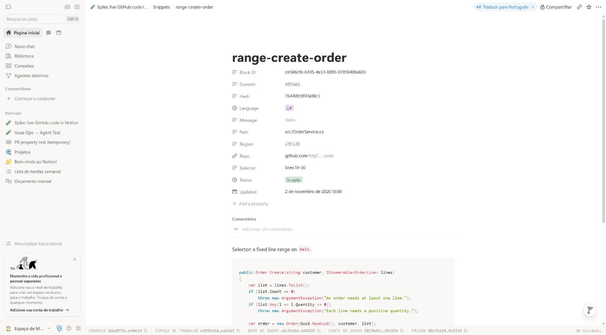

### Change detection

The hash is for one row only: language, `path#Lx-Ly` and the selected code text. The commit is not in the hash.

| Change in a push | Result for a row | Notion calls |
|---|---|---|
| Other file, or other region of the same file | No write | 0 |
| Code of the region | Write block and row | 2 |
| Lines above the region only | Write: the caption range changed | 2 |
| Row finds no code | `Status` = Error, run fails | 1, then 0 while the error stays |

Each run also does 1 database query for each 100 rows.

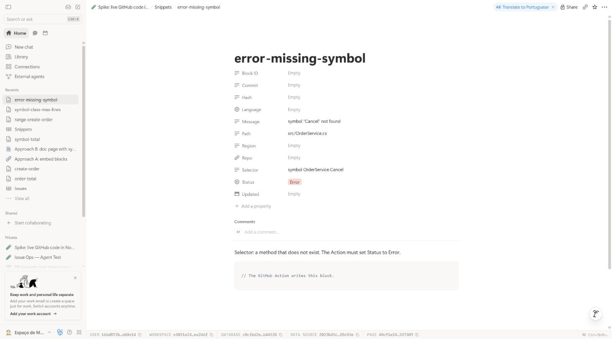

### Triggers

| Trigger | Mode | Purpose |
|---|---|---|
| Push to `main` (PR merge) | apply | Write the blocks that changed |
| Pull request | plan | List the blocks that the merge changes. Writes nothing |
| Nightly schedule | apply | Give code to rows added in Notion |
| Manual (`gh workflow run`) | plan, apply or force | `force` writes all blocks again |

A Notion button that starts the workflow (`repository_dispatch`) is possible, but the spike did not test it.

### Test runs

| Run | Event | Result | API calls |
|---|---|---|---|
| [41487744189](https://github.com/MgCohen/notion-snippet-spike/actions/runs/41487744189) | First registry run | 9 new | 31 (finds block IDs) |
| [41488112900](https://github.com/MgCohen/notion-snippet-spike/actions/runs/41488112900) | [PR #1](https://github.com/MgCohen/notion-snippet-spike/pull/1) plan | 8 will update, 1 unchanged | 1 |
| [41488181759](https://github.com/MgCohen/notion-snippet-spike/actions/runs/41488181759) | Merge of PR #1 | 8 updated, 1 unchanged, 18 s | 17 |
| [41488311983](https://github.com/MgCohen/notion-snippet-spike/actions/runs/41488311983) | Manual, 1 bad row | 9 unchanged, 1 error | 2 |
| [41488890457](https://github.com/MgCohen/notion-snippet-spike/actions/runs/41488890457) | Push of README only | 9 unchanged, 1 known error | 1 |
| [41489969135](https://github.com/MgCohen/notion-snippet-spike/actions/runs/41489969135) | Push `9c420b3`, all options test | 8 updated, 22 s | 17 |

PR #1 added 3 lines above `Create` and changed `Total`. The pinned range was the only unchanged row.

### Line numbers

Notion code blocks have no line-number option. Each block gets a caption with the real range, for example `src/OrderService.cs#L19-L30 @ a9fcaa5`. The caption links to GitHub at that commit and range.

### Search, Notion AI and MCP

| Reader | Result |
|---|---|
| Notion search | Found the new code some seconds after the run |
| Notion AI | Quoted `return Math.Round(subtotal, 2, MidpointRounding.AwayFromZero);` |
| Notion MCP `fetch` | Returns the code on the row page and the doc page |

- A search hit points to the row page, not to the doc page with the synced block reference.
- The MCP `fetch` does not return the caption.

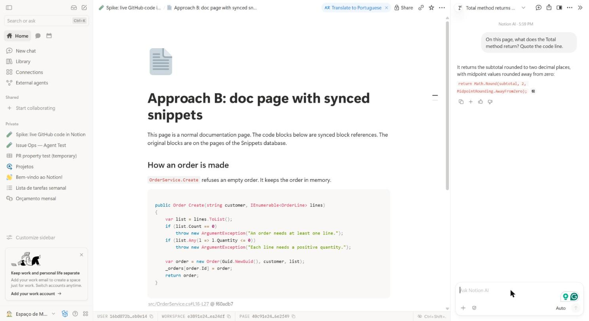

## Related tools

No known tool writes a code region into a native Notion code block (search of November 2026).

| Tool | What it does | Gap |
|---|---|---|
| [SnippSync](https://www.producthunt.com/p/snippsync/snippsync) | Line range from GitHub, updates on push | iframe embed, like Approach A. Paid |
| [notion-docs-sync](https://github.com/imnotjames/notion-docs-sync), [sync-repo-docs-to-notion](https://github.com/pechorin/sync-repo-docs-to-notion) | Repo Markdown files to Notion pages | Full pages only |
| [Notion GitHub integration](https://www.notion.com/zh-cn/help/guides/bring-your-codebase-into-context-with-notions-github-integration) | PR and issue previews, line permalinks | A link, no code |
| [MarkdownSnippets](https://mysticmind-dev.pages.dev/how-to-keep-dotnet-documentation-code-samples-in-sync-with-code-base), [snex](https://github.com/pellepelster/snex), [Swimm](https://docs.swimm.io/ide-integrations/vs-code/ide-plugins-vscode-keep-docs-up-to-date) | Snippets in repo docs stay equal to code | Markdown in the repo, not Notion |

## Setup for Approach B

1. Make an internal Notion integration with "read content" and "update content".
2. Connect the integration to the page that holds the Snippets database.
3. Run `gh secret set NOTION_TOKEN -R <owner>/<repo>`. Do not commit the token.
4. Copy `tools/snippet_range.py` and `tools/sync_snippets.py` of the plugin to `.github/notion-snippets/`, and `workflow/notion-snippets.yml` to `.github/workflows/`.
5. Run `gh variable set NOTION_SNIPPETS_DATABASE -R <owner>/<repo> -b <database-id>`.
6. For each code block, add a row with `File`, a `Method` or a line range, and an empty code block.
7. Run `gh workflow run notion-snippets.yml -f mode=plan` to see the result first.

## Limits and open points

Found by an independent audit of this report, not yet fixed:

- A row with an error fails the run one time only. Later runs show "error (known)" and succeed.
- An insert directly after the last line of a `lines` range makes the range grow. Ranges do not follow a file rename.
- The method search cannot select an overload by signature, only by its position (Overload).
- Many rows on one file: lines added at the top rewrite all of them (2 calls each). Not tested against the Notion rate limit.
- The native Notion GitHub link preview (OAuth, private repos) was not tested.

- Do not edit a synced code block in Notion. The next change of that row replaces the edit.
- The method search reads C-like syntax with a small parser. It does not read JavaScript regex literals with braces, tuple return types, or arrow functions without a semicolon. Roslyn or tree-sitter is more correct.
- Notion makes `OrderService.Total` in a text property a link. The script reads the plain text, so the method still works.
- The Notion token was shared in a chat. Rotate it in the Notion integration settings, then run `gh secret set NOTION_TOKEN` again.
